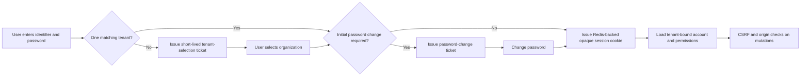
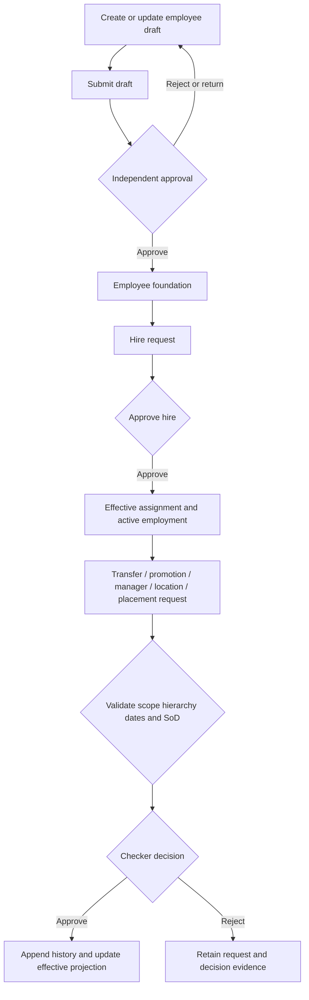
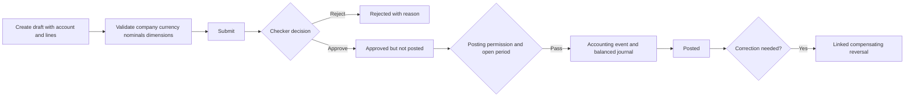
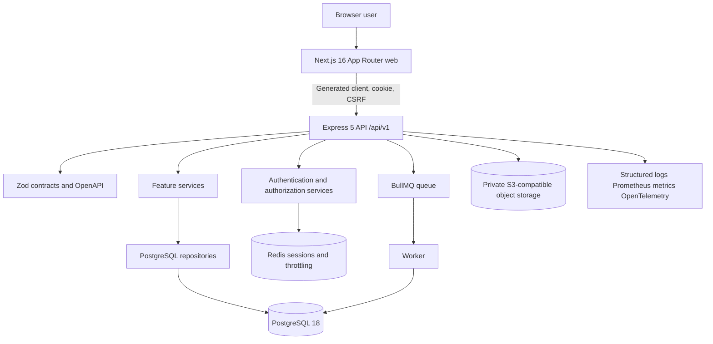

# Nexora ERP Complete Analysis and Senior Review

**Prepared for:** Senior review by Mr. Zeeshan / Mr. Vishan (recipient name requires confirmation)  
**Prepared on:** 22 October 2026  
**Organization:** Xyric Solutions LLP  
**System:** Nexora ERP  
**Assessment basis:** Current workspace, including uncommitted working-tree content; no application or business data was modified

## Table of contents

1. [Executive Summary](#1-executive-summary)
2. [ERP Introduction and Background](#2-erp-introduction-and-background)
3. [Problem Statement](#3-problem-statement)
4. [ERP Objectives](#4-erp-objectives)
5. [Project Scope](#5-project-scope)
6. [Stakeholders and User Roles](#6-stakeholders-and-user-roles)
7. [ERP Modules and Features](#7-erp-modules-and-features)
8. [Business Processes and Workflows](#8-business-processes-and-workflows)
9. [Functional Requirements](#9-functional-requirements)
10. [Technical Architecture](#10-technical-architecture)
11. [Database and Data Management](#11-database-and-data-management)
12. [Security and Access Control](#12-security-and-access-control)
13. [Reports Dashboards and Analytics](#13-reports-dashboards-and-analytics)
14. [Non Functional Requirements](#14-non-functional-requirements)
15. [Current Implementation Status and Gap Analysis](#15-current-implementation-status-and-gap-analysis)
16. [Problems Resolved and Expected Business Benefits](#16-problems-resolved-and-expected-business-benefits)
17. [Risks Limitations and Dependencies](#17-risks-limitations-and-dependencies)
18. [Testing and Quality Assurance](#18-testing-and-quality-assurance)
19. [Recommendations for Improvement](#19-recommendations-for-improvement)
20. [Proposed Roadmap](#20-proposed-roadmap)
21. [Open Questions for Senior Review](#21-open-questions-for-senior-review)
22. [Final Assessment](#22-final-assessment)
23. [Glossary](#23-glossary)
24. [Evidence and Review Coverage](#24-evidence-and-review-coverage)

# 1. Executive Summary

Nexora is a multi-tenant ERP prototype and production-foundation project intended to support service, trading, and manufacturing organizations from one modular application. Its product catalogue is broad: the current prototype inventory records 35 modules, 146 navigation groups, and 792 screen entries. This breadth is primarily a reviewable user-experience specification. It must not be interpreted as 792 production-ready business capabilities.

The current TypeScript implementation is materially stronger than a static prototype. It includes a Next.js 16 web application, an Express 5 versioned API, PostgreSQL source-ledger migrations, Redis-backed sessions and queues, S3-compatible private object storage, a BullMQ worker foundation, generated OpenAPI client code, observability packages, Docker composition, and a multi-layer automated test suite. Production-backed functionality is concentrated in:

- authentication, tenant selection, cookie sessions, password change, and logout;
- governed Identity and Access administration, including roles, assignments, access reviews, delegation, impersonation, session policies, audit, and selected emergency/override controls;
- selected HR employee-master and employment-lifecycle workflows;
- Banking account governance, payments, receipts, approval context, posting, and reversal;
- Finance chart-of-accounts master data, central chart templates, company adoption/classification, and fiscal calendar/period controls;
- company-scoped project and location reference masters;
- operational health, metrics, tracing seams, database migrations, and a sample durable job path.

Most Sales, AR, AP, Procurement, Inventory, Costing, Tax, Manufacturing, Projects, Assets, Expenses, Documents, CRM, Portals, Notifications, Integrations, AI, Audit, Migration, Mobile, Fleet, dashboard, and reporting experiences remain prototype-only or are represented by plans and historical evidence rather than current API composition. HR Payroll has substantial schema and historical design evidence, but the current Express composition does not expose payroll, attendance, leave, or benefits workflows. Banking transfers, statement import, matching, reconciliation, cash forecasting, and treasury instruments are also not production-backed in the current API.

The strongest aspects are the explicit separation between prototype and live functionality, tenant/company security controls, maker-checker and segregation-of-duties patterns, additive migrations, idempotency, optimistic concurrency, immutable event/audit patterns, generated contracts, and a serious automated-test structure. The highest-priority concerns are scope ambiguity, documentation drift, incomplete end-to-end modules, business-policy decisions still open, pending controlled user acceptance in several live areas, a sample-only worker, unproven backup/restore and disaster recovery, and a repository-wide lint baseline independently confirmed during this review at 112 errors and one warning.

The correct overall characterization is: **an advanced ERP prototype with a credible production platform and several production-backed vertical slices, but not a production-ready complete ERP**.

# 2. ERP Introduction and Background

Nexora is being developed as a common ERP platform for organizations with service, trading, and manufacturing operating models. The screen catalogue changes emphasis by company mode: service organizations prioritize subscriptions, projects, resources, support, HR, expenses, and Finance; trading organizations prioritize Sales, Purchasing, Inventory, Costing, Banking, AR/AP, and Tax; manufacturing organizations add product engineering, MRP, production execution, quality, traceability, and variance analysis.

The project follows a staged prototype-to-production strategy. The prototype shell supplies a broad, navigable product specification and reusable screen patterns. Accepted production slices replace mock paths incrementally through contracts, API routes, services, repositories, PostgreSQL migrations, authorization, audit, and tests. This distinction is explicitly stated in `README.md`, `PROTOTYPE-INVENTORY.md`, `app/shell/prototype-content.tsx`, and the current delivery plans.

The intended business spine is documented as:

> Master Data → Transaction → Workflow → Approval → Operation → Accounting Event → Posting Engine → Journal → General Ledger → Reporting → Analytics → Audit

Current implementation follows this spine most clearly in Bank Payment and Bank Receipt workflows, where approved operational records use the Finance posting service and preserve linked event and reversal evidence. Many other modules have only the presentation layer and therefore do not yet complete this chain.

# 3. Problem Statement

The repository does not contain an approved current-state study of the organization’s manual processes. The problems below are therefore divided between project-confirmed control goals and business assumptions requiring stakeholder validation.

| Problem or need | Evidence status | Current or expected impact | Nexora response | Potential measure |
|---|---|---|---|---|
| Disconnected business data across companies and departments | Confirmed product objective; organizational baseline not documented | Duplicate records, inconsistent context, weak cross-module traceability | Tenant/company-scoped masters, shared contracts, reference masters, common shell and future module integrations | Duplicate-rate, master-data completeness, reconciliation exceptions |
| Unauthorized or excessive access | Confirmed technical risk | Fraud, privacy exposure, control failure | Exact permission catalogue, governed roles/assignments, RLS, access review, delegation, impersonation controls | Access-review completion, denied unauthorized attempts, orphaned access count |
| Self-approval and weak accountability | Confirmed design concern | Uncontrolled changes or financial actions | Maker-checker, SoD rules, separate approval/posting, immutable audit, governed exceptional override | Self-approval exceptions, approval ageing, audit completeness |
| Non-repeatable financial setup and posting | Confirmed in Finance/Banking design | Inconsistent account use, unbalanced or duplicate postings | Governed nominal lifecycle, chart templates, period locks, idempotency, balanced posting service | Posting failure rate, duplicate prevention, period exception count |
| Manual employee lifecycle administration | Supported by implemented HR workflows; current organizational baseline unverified | Slow hires/movements, incomplete history, weak evidence | Governed employee drafts, hire and movement requests, immutable status/lifecycle/profile history | Cycle time, returned requests, missing-field rate, history completeness |
| Slow or opaque payment/receipt processing | Supported by implemented Banking workflow design; baseline unverified | Delays, control risk, reconciliation burden | Draft/submit/approve/post/reverse lifecycle with assigned approver and project/location context | Processing time, rejected items, unreconciled items, reversal rate |
| Limited management visibility | Confirmed target; live coverage is partial | Decisions based on stale or simulated information | Role dashboards, reporting catalogue, drill engine, future live read models | Data freshness, dashboard adoption, report preparation time |
| Repetitive work and manual re-entry | Assumption requiring confirmation | Error and delay | Shared masters, generated client, reusable workflows, planned integrations | Manual touch count, correction rate, time per transaction |
| Weak recovery and operational assurance | Confirmed technical gap | Longer outage or data-loss risk | Deployment/runbook foundation exists; backup/restore/DR evidence remains required | Restore success, measured RPO/RTO, failed-job recovery |

# 4. ERP Objectives

## 4.1 Confirmed objectives

1. Provide a single modular ERP product for service, trading, and manufacturing contexts.
2. Isolate tenants and authorized companies at session, API, repository, database, reporting, and UI boundaries.
3. Centralize governed master data and stable identifiers.
4. Replace prototype-only capabilities with production slices without misrepresenting mock actions as live transactions.
5. Enforce least privilege, maker-checker, segregation of duties, idempotency, concurrency controls, and auditable lifecycle transitions.
6. Keep Finance as the controlled ledger-writing boundary; operational modules must not write journals directly.
7. Preserve traceability from source transaction through posting, reporting, and audit.
8. Support versioned `/api/v1` contracts usable by the web application and a future mobile client.
9. Maintain buildable, testable modules with generated contracts and additive migrations.

## 4.2 Suggested objectives requiring approval

- Reduce employee and financial approval cycle time.
- Reduce duplicate or inconsistent master records.
- Improve first-time-right transaction submission.
- Shorten month-end close and reconciliation work.
- Improve report freshness and confidence.
- Establish measurable user adoption and task-completion quality.
- Prove recoverability and service continuity before production promotion.

## 4.3 Suggested success indicators

No baselines or guaranteed improvements are present. Recommended measures are median and 95th-percentile workflow cycle time, first-pass acceptance rate, rejected/returned request count, duplicate detection rate, stale-access count, reconciliation differences, posting/reversal exceptions, report freshness, active-user adoption, support incidents, successful restore time, and audit-evidence completeness.

# 5. Project Scope

## 5.1 In scope confirmed by current implementation

- Next.js web shell, login, responsive navigation, search, role/company review modes, and reusable UI primitives.
- Express API under `/api/v1` with standard problem responses, validation, request context, logging, readiness, OpenAPI, and protected metrics.
- PostgreSQL, Redis, private S3-compatible storage foundation, and BullMQ worker foundation.
- Tenant-aware email/password login, organization selection, initial-password change, Redis session lifecycle, CSRF/origin checks, logout, and session rotation.
- Governed users, roles, permissions, company-role assignments, approvals, audit, access review, delegation, impersonation, session policy, selected super-administrator override, and Bank self-approval grants.
- HR employee/draft directory, draft governance, contacts, emergency contacts, restricted document metadata, assignments, jobs, lifecycle policies, hire, transfer, promotion, manager change, work-location change, organization-placement change, and employee history reads.
- Banking account governance; Bank Payment and Receipt lists, entry, update, submit, approval/rejection, approver reassignment, post, and reverse.
- Finance nominal master, chart hierarchy, central chart template import/publish/read, company adoption/classification, fiscal calendars, period generation, and controlled period-status transitions.
- Company-scoped project and location/city reference masters.
- Automated unit, contract, integration, security, performance, legacy, end-to-end, and accessibility test structures.

## 5.2 Documented or prototype scope not yet fully implemented

The 35-module screen catalogue is an approved review surface, not an approved production release scope. Prototype-only areas include most of Dashboard, Sales, Revenue, AR, Procurement, AP, Inventory, Costing, Tax, Operations, Manufacturing, Quality, CRM, Projects, Resource Management, Helpdesk, Payroll, Assets, Expenses, Documents, Budgeting, Reports, Portals, Configuration, Workflow, Notifications, Integrations, AI, Audit, Migration, Mobile, and Fleet.

## 5.3 Explicitly outside current verified scope

- Direct bank connectivity and payment release to a financial institution.
- Real OCR, email/SMS delivery, AI inference, portal transactions, and mobile offline synchronization.
- Complete AR/AP, Sales, Procurement, Inventory, Manufacturing, Tax, Asset, Expense, Project, and Subscription accounting flows.
- A complete production identity-provider integration; current runtime uses first-party credentials and sessions.
- Provider-specific HA, failover, backup, restore, disaster recovery, SIEM, and key-management operations.
- Any capability represented only by a prototype action, fixture, design document, historical Python reference, or migration without current API composition.

## 5.4 Scope clarification required

- Minimum sellable ERP modules and the order of completion.
- Launch countries, accounting framework, tax/localization scope, and statutory evidence.
- Fiscal-calendar variants beyond regular 12-month years.
- Bank connectivity, reconciliation, cheque/PDC, and treasury depth.
- Inventory valuation, negative-stock, landed-cost, and warehouse depth.
- Sales pricing, credit, delivery/invoice recognition, returns, and commission policy.
- HR/payroll launch depth, statutory ownership, benefits, and self-service.
- Production SSO/MFA policy, hosting provider, recovery objectives, data retention, and compliance obligations.

# 6. Stakeholders and User Roles

## 6.1 Confirmed stakeholder categories

| Stakeholder | Responsibility | Expected access and decisions |
|---|---|---|
| Product owner / senior sponsor | Product scope and release priorities | Approves minimum sellable scope and unresolved product decisions |
| CFO / Finance owner | Accounting policy, chart, periods, posting and reporting | Finance setup, approval policy, period control, accounting decisions |
| Treasury / Banking owner | Bank accounts, payment/receipt controls and reconciliation policy | Banking approval matrix, account governance, release/reconciliation decisions |
| HR owner | Employee lifecycle and payroll policy | HR masters, lifecycle policy, workforce workflows, sensitive-data rules |
| Security owner / tenant administrator | Identity, roles, access review and session policy | Governed access administration; not unrestricted business approval by default |
| Department managers | Operational approvals and review | Company/department-scoped queues and reports |
| Makers / preparers | Create and submit transactions or change requests | Cannot approve their own governed work except an explicitly audited exception |
| Checkers / approvers | Independent decision on submitted records | Scoped decision rights, comments, version checks and audit evidence |
| Posters / Finance operators | Execute approved accounting impact | Separate posting permission and open-period controls |
| Auditors / reviewers | Read evidence and control history | Read-only audit, access and transaction evidence |
| Employees / self-service users | Future personal HR actions | Restricted own-record access; current self-service is not complete |
| Platform / DevOps team | Deployment, monitoring, backup, recovery | Infrastructure access outside normal ERP business authorization |

## 6.2 Prototype personas

The UI defines 20 visual personas, including Chief Executive, CFO, Finance Manager, Accountant, Sales Manager, Sales Executive, Purchasing Manager, Procurement Officer, Inventory Manager, Warehouse Operations, Production Manager, Project Manager, HR Manager, Administrator, CRM Manager, AR, AP, Tax Manager, Auditor, and Viewer. These filters demonstrate tailored navigation and dashboards; they are **not production authorization**.

## 6.3 Production authorization roles

Production roles and permissions are tenant data, not a hard-coded list. Evidence includes a global `super_administrator` exceptional role, company-scoped role policies, makers/checkers, Bank self-approval grants, and exact permission keys. Role names must not be inferred from prototype personas. The organization’s final role catalogue and responsibility matrix require business approval.

# 7. ERP Modules and Features

The complete screen-level inventory is in `ERP_Feature_Inventory.md`. The table below summarizes all 35 modules and the current implementation boundary.

| Module | Purpose and principal features | Current inputs and outputs | Status | Main limitation / recommended next step |
|---|---|---|---|---|
| Dashboard / Overview | Role KPIs, tasks, alerts, drill-down | Fixture metrics; prototype navigation | Partially implemented | Most figures are fixture-derived; define governed KPI dictionary and live read models |
| Banking & Treasury | Accounts, payments, receipts, transfers, statements, reconciliation, treasury | Live accounts/payments/receipts and Finance postings; other screens use fixtures | Partially implemented | Complete transfers, statement import/matching/reconciliation and bank-release policy |
| Sales & Billing | Quote-to-order-to-delivery-to-invoice | Prototype forms and documents | Planned / UI prototype | Confirm pricing, credit, tax, fulfilment and accounting rules |
| Revenue & Subscriptions | Contracts, obligations, recognition, subscriptions and recurring billing | Prototype screens | Planned / UI prototype | Decide accounting policy, evidence, proration and billing scope |
| Customers / AR | Customer profiles, open items, collections, statements | Prototype screens | Planned / UI prototype | Build customer master, AR subledger, allocations and credit control |
| Purchases & Procurement | Requisition, sourcing, PO, receipt, match | Prototype screens; historical designs only | Planned in current TypeScript runtime | Revalidate required slice before claiming prior reference behavior |
| Suppliers / AP | Supplier onboarding, bills, ageing, payment proposals | Prototype screens | Planned / UI prototype | Define KYC, duplicate detection, matching and payment selection |
| Inventory & Warehousing | Items, locations, movements, traceability, valuation | Prototype screens | Planned in current TypeScript runtime | Decide valuation, negative stock, traceability and WMS depth |
| Costing & Landed Cost | Cost policies, allocation, standard/actual cost, variance | Prototype screens | Planned / UI prototype | Approve eligible charges and allocation/valuation policy |
| Finance & Accounting | CoA, templates, nominals, periods, journals, GL, reports | Live master/period APIs and Banking posting service; remaining UI largely mock | Partially implemented | Expose governed journals/GL/reporting and close orchestration end to end |
| Taxation & Compliance | Registrations, tax rules, returns and evidence | Prototype screens and localization documents | Planned / unverified runtime | Confirm launch jurisdictions and statutory authority |
| Operations | Work orders, dispatch, execution, incidents | Prototype screens | Planned / UI prototype | Define industry-specific operational model |
| Production / Manufacturing | BOM, routing, MRP, production, WIP, variance | Mature prototype workspace | Planned / UI prototype | Confirm manufacturing costing and execution depth |
| Quality Management | Plans, inspections, quarantine, CAPA, recall | Prototype screens | Planned / UI prototype | Define mandatory quality gates and traceability integration |
| CRM | Accounts, leads, opportunities, activities and forecast | Prototype screens | Planned / UI prototype | Confirm CRM versus Sales ownership and pipeline rules |
| Projects & Professional Services | Portfolio, WBS, budget, delivery, billing, profitability | Live project reference master only; business screens mock | Partially implemented foundation | Build project contract, time/cost, billing and accounting flows |
| Resource Management | Skills, capacity, allocation and utilization | Prototype screens | Planned / UI prototype | Define resource calendar, approval and utilization measures |
| Helpdesk / Support / AMC | Tickets, SLA, contracts, entitlements | Prototype screens | Planned / UI prototype | Decide service-desk and contract scope |
| HR & Payroll | Employee master, lifecycle, attendance, leave, payroll, performance | Selected live employee/lifecycle APIs; other screens and payroll are mock | Partially implemented | Finish audit view, attendance/leave/payroll and controlled UAT |
| Fixed Assets & Leases | Asset register, depreciation, revaluation, leases | Prototype screens | Planned / UI prototype | Define capitalization, depreciation, custody and lease policy |
| Expense Management | Claims, OCR, cards, advances and reimbursement | Prototype screens | Planned / UI prototype | Confirm policy, receipt evidence and settlement integration |
| Document Management | Library, versions, retention and legal hold | Private object-storage foundation; no live document module | Partially implemented foundation | Bind metadata, authorization, retention and malware scanning |
| Budget & Planning | Models, scenarios, workflow, forecasts, variance | Prototype screens; historical Finance design references | Planned / UI prototype | Confirm dimensions, commitment stages and version policy |
| Reports & Analytics | Catalogue, runner, exports, executive/module reports | Extensive mock report workspace; selected live detail views only | Partially implemented | Build source-backed, permission-aware report definitions and freshness |
| Portals | Customer, supplier and employee self-service | Prototype screens | Planned / UI prototype | Define external identity, isolation and supported transactions |
| Administration & Multi-Tenancy | Tenants, companies, users, roles and audit | Identity & Access is live; wider admin catalogue partial | Partially implemented | Complete controlled browser acceptance and environment operations |
| System Configuration | Company, fiscal, currency, sequences, dimensions and features | Fiscal calendar and selected masters live | Partially implemented | Establish configuration versioning and decision ownership |
| Workflow / Approvals / SoD | My work, definitions, routing, escalation, SoD | Embedded governed workflows exist; generic designer/monitor is mock | Partially implemented | Centralize workflow engine/monitor only where it does not weaken domain rules |
| Notifications | Inbox, templates, routing and delivery | UI prototype only | Planned | Choose channels, retries, preferences and delivery evidence |
| Integrations | Connections, clients, webhooks, mapping, retries | API/storage/queue foundations; no business connectors | Partially implemented foundation | Define first connectors, secrets boundary and replay/reconciliation |
| AI Assistant | Assistant, extraction, forecasting and governance | Client-side mock engine/workspace | Planned / UI prototype | Approve use cases, providers, privacy, human review and evaluation |
| Audit & Compliance | Audit explorer, evidence packs, retention and exceptions | Domain audit exists; broad audit workspace is mock | Partially implemented | Build unified permissioned evidence view and retention/export policy |
| Data Migration & Cutover | Mapping, dry run, reconciliation, sign-off | Migration tooling exists for schemas/catalogues; product workspace mock | Partially implemented foundation | Define governed customer-data migration and cutover controls |
| Mobile | Approvals, scan, expenses, time, offline | Prototype screens | Planned | Define token model, secure storage and offline conflict policy |
| Fleet Management | Vehicles, drivers, trips, fuel, maintenance and compliance | Mature prototype workspace | Planned / UI prototype | Confirm whether Fleet is sellable core or optional vertical |

## 7.1 Production-backed module rules

### Identity and Access

Inputs include governed user, role, assignment, review, delegation, impersonation, and policy requests. Outputs include effective authorization, lifecycle records, revoked sessions, and immutable audit evidence. Important rules include exact permissions, tenant/company scope, maker-checker, last-administrator protection, impersonation restrictions, idempotency, optimistic versions, and safe session invalidation.

### HR employee lifecycle

Inputs include employee drafts, master references, effective dates, assignments, movement proposals, approvers, and reasons. Outputs include employee/assignment projections and append-retained status, lifecycle, profile, approval, and audit history. Current live scope excludes payroll, attendance, leave, benefits, self-service, and broad HR reporting.

### Banking and Finance

Inputs include company, bank account, posting/value dates, nominal lines, project/location, approver, currency, reason, and version. Outputs include approved/posting states, accounting event, journal and reversal links, and immutable events. Approval is distinct from posting. Closed/missing periods block financial progression. Current live scope excludes transfers and reconciliation workflows.

# 8. Business Processes and Workflows

## 8.1 Tenant-aware login and session

Exceptions include throttled login, invalid credentials, invalid or expired selection/password tickets, inactive accounts, invalid sessions, untrusted origins, and failed CSRF. Session policy can bound idle/absolute duration and force session-version invalidation.

## 8.2 Governed access change

Maker creates a user, role, assignment, delegation, access-review, impersonation, or session-policy request; server validation checks tenant scope, permissions, conflicts, ceilings, and version; an independent checker approves or rejects; activation creates or changes effective authority; session invalidation applies where required; append-only audit and lifecycle evidence record the action. Exceptional global-administrator override exists only when explicit permission, reason, and audit requirements are met.

## 8.3 Governed employee lifecycle

Current exceptions include missing master data, invalid hierarchy/effective dates, company-scope denial, stale versions, self-approval denial, and mutation denial during impersonation. Manual two-user browser acceptance remains incomplete for some HR surfaces.

## 8.4 Bank payment and receipt

The workflow supports assigned approvers, audited reassignment, selected governed self-approval grants, idempotency, version preconditions, and explicit denial. It does not execute external bank release or reconciliation.

## 8.5 Finance nominal and chart lifecycle

Central chart templates are imported and published under tenant authority. A company adopts a template through an explicit preview and mapping process. Ordinary company nominals remain governed drafts until classified, submitted, and approved; protected/module-controlled accounts are not silently exposed as Bank offsets. Direct privileged master changes use separate high-authority controls and audit.

## 8.6 Fiscal calendar and period control

An authorized administrator creates a calendar, generates a regular 12-month year, and explicitly changes period states. Finance users can close/reopen within their permissions; locked reopening requires global administrator authority, confirmation, and reason. Close checks incomplete Bank/accounting work and balances. Period locks coordinate with posting locks. Transition years, 4-4-5, 13-period calendars, and year-level reopen remain out of current scope.

## 8.7 Proposed workflows not yet implemented

Purchase-to-pay, order-to-cash, inventory receiving/issue/valuation, payroll calculation/payment, manufacturing execution, and financial close orchestration are documented product intentions but are not current end-to-end TypeScript workflows. They should not be used for operating procedures until implemented and accepted.

# 9. Functional Requirements

The full traceability matrix is in `ERP_Requirements_Traceability_Matrix.md`.

| ID | Requirement | Module | Priority | Evidence and status | Acceptance summary |
|---|---|---|---|---|---|
| FR-001 | Authenticate by tenant-aware credential flow and issue an opaque server session | Auth | Critical | Implemented and verified in code/tests | Invalid credentials do not enumerate accounts; valid session is tenant-bound |
| FR-002 | Require CSRF and allowed-origin checks for mutations | Platform | Critical | Implemented and verified | Invalid CSRF/origin cannot reach repository mutation |
| FR-003 | Enforce tenant/company/permission scope server-side | Cross-cutting | Critical | Implemented for live APIs | Cross-tenant/company requests fail without data disclosure |
| FR-004 | Govern users, roles, assignments and approvals | Identity | Critical | Implemented; browser sign-off limitation recorded | Maker/checker, version, idempotency, audit and last-admin controls pass |
| FR-005 | Support access review, delegation, impersonation and session policies | Identity | High | Implemented; controlled browser acceptance not fully closed | Authority is bounded, revocable and evidenced |
| FR-006 | Maintain employee drafts and approval | HR | High | Implemented | Approved draft creates governed employee foundation and history |
| FR-007 | Govern hire and assignment changes | HR | High | Implemented; some manual UAT open | Effective changes preserve prior history and validate hierarchy/scope |
| FR-008 | Read bounded employee history without exposing sensitive fields | HR | High | Implemented | Opaque pagination and restricted projection |
| FR-009 | Maintain bank accounts through governed lifecycle | Banking | Critical | Implemented | Company/currency/CoA mapping, maker-checker and audit enforced |
| FR-010 | Create, approve, post and reverse Bank Payments | Banking | Critical | Implemented and browser-tested in plans | Approval does not post; posting is balanced and reversal is linked |
| FR-011 | Create, approve, post and reverse Bank Receipts | Banking | Critical | Implemented and browser-tested in plans | Same control standard as payment, with debit-bank/credit-nominal posting |
| FR-012 | Govern Bank approver reassignment and self-approval grants | Banking/Security | High | Implemented | Grant/reassignment is scoped, versioned, revocable and audited |
| FR-013 | Maintain company nominal accounts and hierarchy | Finance | Critical | Implemented | Classification and lifecycle prevent unauthorized posting use |
| FR-014 | Maintain central chart templates and company adoption | Finance | High | Implemented foundation | Preview is deterministic; adoption does not auto-approve ordinary accounts |
| FR-015 | Maintain fiscal calendars and controlled period status | Finance | Critical | Implemented for regular 12-month years | Overlap/date guards, period locks, close checks and immutable events |
| FR-016 | Maintain company-scoped projects and locations | Master Data | Medium | Implemented | Bounded list and versioned audited mutation |
| FR-017 | Publish and process durable business jobs | Worker | Medium | Only sample job implemented | Business-specific job must persist status, retry safely and dead-letter |
| FR-018 | Store private business documents | Documents | High | Storage service/foundation only | Business metadata, authorization, retention and malware controls required |
| FR-019 | Produce source-backed dashboards and reports | Reporting | High | Mostly prototype | Every live figure reconciles to source and shows freshness/scope |
| FR-020 | Complete journal, ledger and financial statement workflows | Finance | Critical | Planned/partial | Governed journal lifecycle and reconciled reports required |
| FR-021 | Complete Bank transfers and reconciliation | Banking | High | Planned | Transfer, import, matching, close/reopen and zero/approved difference |
| FR-022 | Complete attendance, leave, payroll and payment handoff | HR/Payroll | Critical if in launch | Planned in current API | Deterministic calculation, statutory snapshot, approval, lock and finance handoff |
| FR-023 | Complete AR/AP and order/procurement flows | Commercial | High if in launch | Planned | Open items, allocations, matching, fulfilment, posting and reconciliation |
| FR-024 | Keep prototype-only actions visibly non-durable | UX | Critical | Implemented by labels in many surfaces; inconsistent risk remains | No mock action can be mistaken for production persistence |

# 10. Technical Architecture

## 10.1 Frontend

- Next.js 16.3.8, React 19.3, TypeScript 5.9, App Router.
- Feature-first ownership under `app/features`, shell composition under `app/shell`, shared presentation under `app/shared`, and shadcn-style primitives under `app/components/ui`.
- Hash-based ERP workspace routing inside the shell; `/admin/identity` remains a compatibility route.
- Tailwind 4 migration is in progress. Legacy feature CSS remains and must be retired only after selector verification.
- Production-connected screens use generated API methods; many catalogue screens intentionally use fixtures.

## 10.2 Backend

- Express 5 API in `server/api` with modular routers for auth, security, HR, Banking, Finance, master data, jobs, health, OpenAPI and metrics.
- Service and repository layers exist for implemented slices. Browser code does not connect directly to databases or Redis.
- Zod schemas and generated OpenAPI/client artifacts are owned by `packages/contracts`.
- Standard problem responses, correlation IDs, request logging, body-size limits, Helmet, CORS, readiness and graceful shutdown are present.

## 10.3 Persistence and infrastructure

- PostgreSQL is the business system of record; source migrations are grouped by platform, security, workflow, Finance, HR, master data and runtime.
- Redis holds active sessions, throttling, selection/password-change tickets, policy caches and BullMQ state.
- MinIO supplies private S3-compatible storage; the bucket is configured without anonymous access.
- The worker persists job execution status in PostgreSQL, but currently processes only a sample job.
- Docker Compose separates migration, API, worker and web services and uses different database credentials for bootstrap, migration and application roles.

## 10.4 Deployment status

Local production-shaped composition and CI exist. Provider-specific production topology, SSO, KMS/vault, HA, failover, backup/restore, SIEM, alert ownership and operational rehearsal are not verified in the current repository. Historical deployment documentation references an older Python/FastAPI layout and must not be used without reconciliation to the current TypeScript monorepo.

# 11. Database and Data Management

## 11.1 Core entity groups

| Domain | Representative entities | Relationships and controls |
|---|---|---|
| Platform | tenant, company/legal entity, organization unit, currency, fiscal calendar/version, period, project, location | Tenant/company roots; effective and versioned configuration |
| Security | user account, password credential, permission definition, role policy, grant, assignment, approval, access review, delegation, impersonation, session policy, audit event | Exact permissions; effective assignments; append-retained decisions; RLS |
| HR | employee, employee draft, employment relationship, assignment, contact, emergency contact, document metadata, lifecycle policy/request/event, profile history, job | Employee belongs to tenant/company; effective assignments/history preserve prior evidence |
| Finance | account/nominal, section policy, chart template/node/company mapping, accounting event, journal entry/line, fiscal period | Company chart identities; protected controls; balanced postings; period locks |
| Banking | bank account/event, payment/line/event, receipt/line/event, approver assignment/reassignment, self-approval grant | Bank account maps to Finance account; transaction lines map to approved nominals and dimensions |
| Runtime | job execution | Deterministic job ID, status, attempts, correlation and safe error code |

## 11.2 Data ownership and consistency

- PostgreSQL is authoritative for business records, identity, permissions, lifecycle, Finance, and audit.
- Redis is transient authority for active sessions and queue/runtime concerns, not business balances or employee records.
- Company and tenant IDs are carried through session-derived server context; UI selection is not authority.
- Additive migrations use a module/version source ledger. The baseline `packages/db/migrations` chain is historical/incompatible with the adopted source schema and must not become a second authority.
- Mutating live APIs generally require validation, idempotency keys, and optimistic version preconditions.
- Posted financial history and security/audit evidence are corrected through new linked records, not destructive edits.

## 11.3 Data risks and lifecycle gaps

- Historical evidence reported 139 source tables and extensive RLS, constraints and foreign keys, but this assessment did not connect to a live database or recount current schema objects.
- Retention, archival, legal hold, subject-right handling, and deletion/pseudonymization policy are not approved end to end.
- Backup and restore mechanisms are deployment responsibilities and lack current executed recovery evidence.
- Imported chart definitions can be structurally valid while still requiring Finance ownership/classification decisions.
- Customer migration templates, reconciliation, exception handling and cutover sign-off remain product scope, not current runtime capability.

# 12. Security and Access Control

## 12.1 Verified controls in current code or tests

- Tenant-aware authentication with generic invalid-credential responses and login throttling.
- Host-only `HttpOnly`, `Secure`, `SameSite=Strict` production cookie behavior.
- Redis-backed opaque sessions with idle/absolute expiry, rotation, logout and version invalidation.
- CSRF and allowed-origin validation for mutations; CORS credentials restricted to configured origins.
- Exact permission evaluation, company/organizational scope, field rules, source-state rules, static/dynamic SoD, and deny-by-default behavior.
- PostgreSQL RLS and tenant/company predicates in production-backed repositories.
- Idempotency, optimistic concurrency and immutable or append-retained event/audit patterns on governed workflows.
- Restricted impersonation, visible real-actor context, mutation blocks for Identity and HR, and emergency-principal constraints.
- Redaction of password, TOTP, recovery, identity-number and salary-like fields from structured logs.
- Protected `/metrics`, readiness checks, dependency scanning, secret scanning and container scanning in CI configuration.
- Encryption helper for sensitive Banking identifiers, with key-version configuration.

## 12.2 Unverified or incomplete controls

- Managed OIDC/SAML, enterprise MFA, centralized revocation and service identity are not implemented.
- Production KMS/vault custody, TLS termination, database encryption, secret rotation, SIEM/archive, alerting and operator monitoring are environment decisions without current evidence.
- Backup protection, restore authorization and disaster-recovery exercises are unverified.
- Full authorization review for prototype-only modules is not possible because those server paths do not yet exist.
- Manual controlled acceptance remains open for some Identity, HR and operator configuration flows.
- The repository-wide lint baseline is not clean, weakening the configured CI release gate.

## 12.3 Potential vulnerabilities and cautions

No exploitable vulnerability is asserted without a reproducible test. Principal risks are accidental exposure when prototype screens become live without server authorization, authorization drift between permission catalogue and business scope, misconfiguration of high-authority override roles, incomplete document/file security, secrets/keys outside a managed vault, and operational compromise of database/audit writers. Every new module should receive threat modelling and permission-matrix tests before activation.

# 13. Reports Dashboards and Analytics

## 13.1 Existing capabilities

- Nineteen role-oriented prototype dashboards with date comparison controls, cards, charts, action queues, exceptions and drill journeys.
- Client-side drill engine for Finance, Sales, Procurement and Inventory fixture data.
- Extensive report catalogue across all 35 modules.
- Printable prototype documents for invoice, purchase order, statement and journal voucher.
- Selected live operational directories, summaries, histories and audit panels in Identity, HR, Banking and Finance.
- CSV/export and browser-print demonstrations on prototype screens.

## 13.2 Limitations

Most dashboards and reports use fixture data or derived mock history. Prototype chart arithmetic and drill consistency are tested, but they do not prove reconciliation to live business records. Generic export and printing do not establish governed reporting, privacy filtering, asynchronous generation, retention or evidence completeness.

## 13.3 Recommended reporting priorities

1. Access-review status, privileged access, session/impersonation and approval audit.
2. Employee lifecycle exceptions, pending approvals and effective-history integrity.
3. Bank account activity, payment/receipt registers, posting exceptions and period blocks.
4. Trial balance, general ledger, Bank-to-GL reconciliation and close status once Finance read models are live.
5. Data-quality and freshness indicators on every live report.

Each report should declare source, company/currency/date context, as-of time, permission basis, filters, reconciliation rule and export classification.

# 14. Non Functional Requirements

| ID | Area | Current evidence | Proposed or historical target | Status |
|---|---|---|---|---|
| NFR-001 | Security | RLS, exact permissions, sessions, CSRF/origin, redaction, security tests | No live operation without server authorization | Implemented for live slices |
| NFR-002 | Data integrity | Constraints, idempotency, versions, append-only events, balanced posting | Deterministic replay and correction without history loss | Implemented for selected slices |
| NFR-003 | Performance | Foundation and 500-user fixture regression budgets | Historical API p95 target under 500 ms requires reapproval and environment testing | Partially verified |
| NFR-004 | Scalability | Stateless API shape, Redis, bounded queries, cursor pagination | Capacity and horizontal-scale evidence per deployment | Unverified |
| NFR-005 | Availability | Liveness/readiness and graceful shutdown | Historical 99.5% target requires owner approval | Unverified operationally |
| NFR-006 | Recovery | Additive migrations and backup-before-UAT practice | Historical RPO ≤15 min / RTO ≤4 hr require reapproval and drills | Not verified |
| NFR-007 | Observability | Correlation, Pino, metrics, tracing seams | Dashboards, alerts, retention and on-call ownership | Partially implemented |
| NFR-008 | Maintainability | Workspaces, feature boundaries, generated contracts, tests | Clean lint/format/type/build gates and reduced legacy CSS | Partially met; lint debt open |
| NFR-009 | Usability | Responsive shell, keyboard search/help, loading/empty/error states | Task-based UAT and role-appropriate density | Partially verified |
| NFR-010 | Accessibility | Shared controls and accessibility suite | WCAG target not explicitly approved; ongoing automated/manual testing | Partially verified |
| NFR-011 | Compatibility | Node 24, current Chromium E2E, responsive screenshots | Supported browser/device matrix | Requires clarification |
| NFR-012 | Privacy/compliance | Restricted HR projection and log redaction | Retention, legal basis, subject rights, data residency and audit policy | Requires clarification |

# 15. Current Implementation Status and Gap Analysis

| Requirement or Feature | Expected Behavior | Observed Implementation | Status | Gap or Risk | Recommended Action |
|---|---|---|---|---|---|
| Prototype catalogue | Reviewable ERP scope with honest labels | 35 modules, 146 groups, 792 entries; inventory has inconsistent Coming Soon totals | Implemented but documentation inconsistent | Reviewers may equate screens with live scope | Generate status badge from one manifest and reconcile counts |
| Authentication/session | Tenant-aware secure login/session | Current API and tests implement it | Implemented and verified | Managed IdP/MFA absent | Decide production identity model |
| Identity administration | Governed access changes | Broad API/UI/database coverage | Implemented; manual acceptance partly pending | UAT credentials/helper gaps in historical acceptance | Run controlled current-environment UAT |
| HR employee master | Governed employee and history | Multiple API-backed pages | Partially implemented | Prototype fallback noted on directory/add flows; manual acceptance open | Remove fallback only after deployment acceptance |
| HR payroll | End-to-end payroll and payment handoff | Migrations/docs exist; current Express router has no payroll endpoints | Documented but not found in current runtime | Serious scope/status confusion | Re-plan current TypeScript payroll slice |
| Bank accounts | Governed master and CoA mapping | API/UI/migrations/tests present | Implemented and verified by automated evidence | Operator business setup remains | Complete owner UAT and permission assignment |
| Bank payments/receipts | Draft through reversal | API/UI/PostgreSQL/posting paths present | Implemented and verified | No bank release/reconciliation | Add only after policy approval |
| Bank transfers | Controlled account-to-account flow | Prototype only | Planned | Cash movement gap | Implement after period and posting review |
| Bank reconciliation | Import/manual matching and close | Mature fixture UI; no current production router | Implemented but not documented as live / actually prototype-only | High risk of mistaken readiness | Mark explicit prototype and build server workflow |
| Finance CoA | Governed hierarchy/nominals/templates | Production-backed current slice | Partially implemented | Business classification decisions remain | Finish owner review and audit reporting |
| Finance periods | Controlled 12-month calendar and status | Implemented through latest migrations/API/UI | Implemented and verified | Nonstandard calendars absent | Clarify launch calendar requirements |
| Journals/GL/statements | Governed accounting core | Posting service used by Banking; no current general journal/GL API composition | Partially implemented | Finance module can be overclaimed | Build end-to-end journal and reporting surface |
| Reference masters | Projects and locations | Company-scoped API/UI present | Implemented and verified | Limited kinds and potential ownership ambiguity | Define master ownership/catalogue |
| Document storage | Private storage and file service | Infrastructure/service exists; no business route composition | Partially implemented | No retention, malware scan or business binding | Design governed document module |
| Background processing | Durable async work | Sample queue/job only | Partially implemented | No business jobs or operational dashboard | Implement first real job with retry/dead-letter UAT |
| Dashboards/reports | Live, reconciled, permissioned insight | Mostly fixture-driven | Partially implemented | Misleading business decisions if labels fail | Add freshness/source labels and live read models |
| CI gate | All configured gates clean | Workflow comprehensive; `npm.cmd run lint` executed during this review and returned 112 errors/1 warning | Blocked | Main branch gate fails on the assessed working tree | Fix lint debt; do not suppress |
| Production operations | Deployable, observable and recoverable | Compose/CI/runbooks exist | Unverified | Provider, HA, KMS, backup/restore, DR and SIEM gaps | Execute production-readiness program |

# 16. Problems Resolved and Expected Business Benefits

| Problem | Root cause evidence | Current functionality | Benefit status | Potential KPI and method | Dependency |
|---|---|---|---|---|---|
| Uncontrolled access changes | Confirmed control requirement | Governed roles/users/assignments/reviews | Demonstrated technically | Approved vs rejected access requests; quarterly stale access | Valid role catalogue and reviewer ownership |
| Self-approval risk | Confirmed workflow concern | Maker-checker and audited exceptions | Demonstrated in tests for selected flows | Self-decision denials; exceptional overrides by reason | Correct permission setup |
| Incomplete employee history | Confirmed implementation target | Status/lifecycle/profile read models | Demonstrated technically | Missing history versions; time to reconstruct change | HR data quality and manual UAT |
| Duplicate/replayed mutations | Confirmed distributed-systems risk | Idempotency keys and deterministic records | Demonstrated in selected tests | Duplicate record count after retry | All future modules adopt pattern |
| Uncontrolled Bank posting | Confirmed financial risk | Separate approval/posting, open-period and balanced-journal controls | Demonstrated technically | Posting exceptions, unauthorized attempts, reversal linkage | Approved chart and periods |
| Inconsistent account setup | Confirmed during chart import | Central template, company adoption and governed nominal lifecycle | Partially demonstrated | Unclassified accounts, rejected adoption conflicts | Finance owner classification |
| Slow employee/bank approvals | Expected, baseline absent | Queues and assigned approvers | Expected benefit only | Median/95th-percentile submit-to-decision time | Real operating volume |
| Limited visibility | Expected, baseline absent | Rich prototype dashboards and selected live registers | Mostly expected | Report preparation time, freshness, reconciliation variance | Live source modules/read models |

# 17. Risks Limitations and Dependencies

| Risk | Likelihood | Impact | Mitigation | Owner |
|---|---|---|---|---|
| Prototype breadth is mistaken for production completeness | High | High | Enforce live/partial/prototype labels from a single manifest | Product + Engineering |
| Requirements and current code drift | High | High | Reconcile blueprint/status docs each accepted slice | Product + BA |
| Open accounting and business-policy decisions | High | High | Decision log with named owner and acceptance date | CFO / domain owners |
| Incomplete end-to-end Finance/HR/Banking workflows | High | High | Finish bounded vertical slices before adding breadth | Product + Engineering |
| Repository-wide lint gate failure | High based on latest handoff | Medium/High | Dedicated maintenance batch, no suppression | Engineering |
| Shared persistent test fixtures contaminate repeat runs | Medium | Medium | Unique isolated fixtures and deterministic cleanup strategy | QA/Engineering |
| Manual UAT gaps | High | High | Named maker/checker/poster scripts and evidence pack | Domain owners + QA |
| Incorrect high-authority override configuration | Medium | High | Restrict principals, require reason, review audit periodically | Security owner |
| Backup/restore/DR not proven | Medium | Critical | Provider decision and executed restore/failover drills | DevOps/CTO |
| Document/file security incomplete | Medium | High | Metadata authorization, scanning, retention and download controls | Security + Product |
| Worker has no real business workload | High | Medium | Implement one bounded production job and operational controls | Engineering/Operations |
| Performance evidence is narrow | High | Medium/High | Volume models and module-specific load/endurance tests | QA/Architecture |
| Sensitive HR/financial privacy requirements unclear | Medium | High | Data classification, retention and field-access review | HR/CFO/Security |
| Working tree contains many uncommitted changes | High at assessment time | Medium | Freeze a reviewed commit before formal sign-off | Repository owner |

# 18. Testing and Quality Assurance

## 18.1 Existing coverage

- Unit tests cover contracts, UI components, auth policy, session behavior, HR client/router, Banking, Finance, master data and shared controls.
- Contract tests cover OpenAPI and security policies.
- PostgreSQL/Redis integration tests cover migrations, authentication, authorization, governed administration, HR lifecycle, Banking, Finance, storage, jobs and tracing.
- Security suites cover foundation controls, tenant/database isolation, Banking, Finance and fiscal-calendar rules.
- Performance tests currently cover in-process liveness/authorization and a 500-user governed user-management fixture.
- Playwright suites cover baseline shell, HR hire, Banking, chart templates/nominals and fiscal periods, with stored desktop/mobile HR baselines.
- Legacy characterization tests validate prototype calculations, drill behavior, Finance documents and HR prototype behavior.
- Accessibility automation and CI configuration are present.

## 18.2 Current quality caveats

Historical plans on 21–22 October report large green focused suites and successful builds, but those results are not a substitute for a fresh clean-commit gate. During this assessment, `npm.cmd run lint` completed with 112 errors and one warning, matching the latest handoff. The findings are primarily accessibility label associations, React effect/state rules, one unused symbol, and one hook-dependency warning across existing application files; none originate in the new Markdown documents. Several historical integration failures were attributed to shared fixture contamination or stale assertions. This analysis does not claim that the entire current suite passes.

The current `npm.cmd run build` command was also executed during this assessment. Project-reference TypeScript checks and the Next.js 16.3.8 production build completed successfully. This confirms buildability of the assessed working tree but does not override the lint failure or replace the unexecuted integration, security, performance, E2E and accessibility suites.

## 18.3 Missing high-value tests

1. Full clean-clone CI on the exact review commit.
2. Restore and point-in-time recovery rehearsal with reconciliation.
3. Multi-instance session, queue, cache-invalidation and failover tests.
4. Business-volume Bank posting and period-close contention tests.
5. End-to-end journal/GL/TB/statement reconciliation when those APIs exist.
6. HR payroll golden-result, statutory boundary, correction and payment-handoff tests.
7. File upload authorization, malware, content-type, size, retention and signed-URL tests.
8. Cross-module permission regression generated from the permission catalogue.
9. Manual accessibility testing and an approved browser/device matrix.
10. Business UAT with distinct maker, checker, poster, auditor and restricted user.

# 19. Recommendations for Improvement

| Priority horizon | Problem or opportunity | Proposed change | Business value | Technical impact | Complexity | Acceptance criteria |
|---|---|---|---|---|---|---|
| Critical | Scope can be overclaimed | Publish one generated capability/status manifest | Trustworthy review and release decisions | Reconcile navigation, API, DB, tests and docs | Medium | Every screen marked Live/Partial/Prototype/Planned with evidence link |
| Critical | Working baseline is not release-clean | Resolve repository lint debt and run full clean-clone CI | Restores enforceable quality gate | Cross-feature maintenance, no suppression | Medium | All mandatory CI gates pass on one commit |
| Critical | Recovery not proven | Select provider and execute backup/restore/DR drill | Reduces catastrophic loss/outage risk | Infrastructure, runbooks, monitoring | High | Approved RPO/RTO measured in rehearsal |
| Critical | Key policy decisions remain open | Convene Finance/HR/Security decision workshops | Prevents engineering invented rules | Update decision register and acceptance tests | Medium | Launch-critical questions have owners and signed decisions |
| Critical | Production identity incomplete | Decide OIDC/SAML/MFA/service identity model | Enterprise security and lifecycle | Auth adapter, session/revocation integration | High | Threat model and full auth UAT accepted |
| Short term | Identity/HR manual acceptance gaps | Run controlled distinct-user UAT | Confirms usable governance | Test accounts, scripts and evidence | Medium | Maker/checker/denial/history flows signed off |
| Short term | Finance module can be overstated | Complete journal/GL/TB/statement vertical slice | Reliable financial system of record | Contracts, APIs, repositories, reports | High | Posting-to-report reconciliation passes |
| Short term | Banking incomplete after posting | Build transfer, statement import and reconciliation plan | Cash control and operational completeness | New domain lifecycle and file handling | High | Idempotent import and zero/approved difference close |
| Short term | HR status ambiguity | Rebaseline current TypeScript HR/Payroll scope | Clear roadmap and safer delivery | Reconcile migrations, API and UI | Medium | Capability matrix approved by HR/Finance |
| Short term | Fixture data may look live | Standardize prominent data-source/freshness indicators | Avoids misleading users | Shared shell/report metadata | Low | Every non-live page visibly says Prototype data |
| Short term | Shared fixture tests can be flaky | Isolate test data per suite/run | Reliable regression evidence | Fixture factory/database naming | Medium | Repeat runs are deterministic without deleting audit history |
| Medium term | Worker is sample-only | Move report/export/import jobs to real durable worker | Scalable long tasks and retry visibility | Job contracts, status UI, alerts | Medium | Retry/dead-letter/replay and audit tested |
| Medium term | Reporting is mostly simulated | Build governed read models and KPI dictionary | Decision-quality information | Query/index/cache/report services | High | Reports reconcile and show freshness |
| Medium term | File handling is incomplete | Implement governed document metadata and scanning | Safe evidence and attachment workflows | Storage service, policies, retention | High | Unauthorized access and unsafe content blocked |
| Medium term | CSS migration and historical paths remain | Finish scoped Tailwind migration and update stale docs | Lower maintenance cost | UI-only phased work | Medium | No active selector depends on retired CSS; build passes |
| Long term | Broad commercial modules absent | Select and complete one vertical value stream | Demonstrable ERP business value | Likely Sales-to-cash or Purchase-to-pay | High | End-to-end transaction, accounting and reconciliation |
| Long term | Multi-jurisdiction claims unclear | Introduce governed localization release process | Safer statutory expansion | Versioned rules/evidence/advisory review | High | Approved pack, provenance and golden calculations |
| Long term | Mobile/portals/AI create new trust boundaries | Treat each as a separate architecture/security program | Avoids premature risk | Tokens, privacy, offline, evaluation | High | Separate threat model and acceptance gate |

# 20. Proposed Roadmap

## Phase 1 — Baseline stabilization

- Freeze a reviewed commit and generate the capability/status manifest.
- Reconcile current README, prototype inventory, implementation status and production plans.
- Remove repository-wide lint failures and flaky/shared-fixture failures.
- Run the full clean-clone CI and record evidence.
- Complete controlled UAT for Identity, current HR and live Banking/Finance administration.

## Phase 2 — Core financial completion

- Confirm accounting framework, account classification, numbering and journal lifecycle.
- Complete manual/system journals, GL, TB, statements, audit drill and close orchestration.
- Finish Bank transfers, statement import, matching and reconciliation after policy approval.
- Add source-backed cash and period-close reports.

## Phase 3 — HR and payroll completion

- Complete cross-workflow HR audit evidence.
- Implement attendance, leave, overtime and locked payroll inputs.
- Implement deterministic payroll, statutory snapshots, approval, payslips, payment batch and Finance/Banking handoff.
- Add HR privacy, retention, export and self-service boundaries.

## Phase 4 — First complete commercial value stream

Choose one based on business priority:

- order-to-cash: customer, quote/order, delivery, invoice, AR, receipt, allocation and reconciliation; or
- purchase-to-pay: supplier, requisition/PO, receipt, match, AP bill, payment and reconciliation.

Do not start both before the selected stream reaches accounting and reporting acceptance.

## Phase 5 — Reporting and operational optimization

- Governed report/KPI dictionary, read models, asynchronous exports and freshness indicators.
- Performance/capacity testing with representative volume.
- Document management, notifications and first external integration.

## Phase 6 — Production readiness and strategic expansion

- Managed identity, provider topology, vault/KMS, HA, backup/restore, DR, SIEM, alerts and incident ownership.
- Release/cutover rehearsal, migration reconciliation and support model.
- Only then expand to manufacturing, advanced warehouse, portals, mobile, AI and optional verticals such as Fleet.

# 21. Open Questions for Senior Review

1. **Who is the intended reviewer: Mr. Zeeshan or Mr. Vishan?** The task names both; document ownership and sign-off should be unambiguous.
2. **What is the minimum sellable ERP release?** Without a bounded module set, the 35-module catalogue encourages breadth without completed value streams.
3. **Which operating model launches first: service, trading, or manufacturing?** This determines priority masters, transactions and reports.
4. **Which legal companies, countries and currencies are in launch scope?** This drives tenant/company design, localization and testing.
5. **Which accounting framework and approved classifications apply?** Engineering cannot decide revenue, inventory, FX, lease, tax or cash-flow policy.
6. **What journal lifecycle and numbering rules are legally required?** Draft/submit/approve/post, direct system posting, reversals and gapless sequences need owner approval.
7. **Are regular 12-month calendars sufficient for launch?** 4-4-5, 13 periods, transition years and adjustment periods are currently unsupported.
8. **What Bank capability is required at launch?** Manual record, file exchange, direct API, cheques/PDC, reconciliation and treasury have materially different risk.
9. **Who owns and approves the imported chart and the remaining exceptional accounts?** Structural import success is not accounting approval.
10. **Should Finance or HR be the next completion priority?** Both are partial and share Banking, period, approval and reporting dependencies.
11. **Which payroll jurisdiction and statutory authority are approved?** The runtime should not imply compliance from historical migration or design documents.
12. **Which HR data is classified as private or restricted, and how long is it retained?** Field permissions exist but policy and retention need approval.
13. **What are the first complete commercial workflows?** Decide order-to-cash versus purchase-to-pay and define acceptance at ledger/report reconciliation.
14. **Which inventory valuation and negative-stock policies apply?** These are prerequisites for trading/manufacturing scope.
15. **What production identity provider, MFA, service identity and revocation policy will be used?** Current first-party auth is not a final enterprise identity decision.
16. **Which hosting provider and recovery objectives are approved?** Provider-neutral composition does not prove HA, backup or DR.
17. **What compliance obligations apply?** No SOC 2, ISO 27001, GDPR, tax or statutory certification should be inferred without formal scope.
18. **May global super-administrator override remain enabled in production?** If yes, define principal count, monitoring, review and incident response.
19. **Which reports are mandatory for go-live and who certifies their reconciliation?** The current catalogue is much larger than the live data sources.
20. **Should Fleet, AI, Mobile and Portals remain roadmap items or be removed from the near-term scope?** Each adds material architecture and support obligations.
21. **Who owns production UAT sign-off and evidence retention?** Current automated strength is not a replacement for business acceptance.
22. **What is the policy for historical documents that reference the retired Python/FastAPI architecture?** They should be archived or marked superseded to prevent operational misuse.

# 22. Final Assessment

Nexora has a strong product vision and a credible production engineering foundation. The project demonstrates unusually deliberate controls for a prototype-stage ERP: explicit mock/live separation, modular contracts, tenant/company security, RLS, governed changes, idempotency, immutable evidence, additive migrations, generated clients, and broad test categories.

Its main strength is not the number of screens; it is the quality of the implemented vertical slices. Its main weakness is the gap between the breadth of the catalogue and the narrowness of production-backed business operations. Documentation contains valuable evidence but also historical architecture, stale statuses, contradictory counts, and implementation claims that no longer match current TypeScript composition.

The immediate priority should be to establish one clean, evidence-backed baseline and then complete whole business value streams rather than add more screens. The first senior decisions should bound the release, approve Finance and business policy, choose the next completion stream, select production identity/hosting/recovery controls, and assign UAT ownership.

Production promotion is not recommended until the release scope is bounded, full CI is green, live reports reconcile, controlled UAT passes, and backup/restore, identity, secrets, monitoring and disaster-recovery controls are demonstrated in the target environment.

# 23. Glossary

| Term | Meaning in Nexora |
|---|---|
| Accounting Event | Validated source-domain instruction to the Finance posting boundary |
| API contract | Versioned Zod/OpenAPI request and response definition |
| Checker | Independent approver of a maker’s submitted record |
| Company scope | Authorized legal-company boundary inside a tenant |
| Idempotency | Repeating the same command does not create duplicate business effects |
| Maker | User who prepares or submits a governed record |
| Nominal | Chart-of-accounts posting account |
| RLS | PostgreSQL row-level security |
| SoD | Segregation of duties; conflicting actions are separated |
| Source migration | Ordered additive migration against the adopted production schema ledger |
| Prototype screen | Reviewable UI behavior using fixtures; not proof of persistence or accounting |
| Production-backed | Connected through contract, API, service, repository, database, authorization and tests |
| UAT | User acceptance testing by representative business roles |

# 24. Evidence and Review Coverage

## 24.1 Principal evidence reviewed

- Repository structure, `package.json`, workspaces, Docker Compose, CI and test configuration.
- `README.md`, `AGENTS.md`, `PROTOTYPE-INVENTORY.md`, functional blueprint, open-question register, UI migration register and production/audit records.
- Current `app/` feature inventory, shell composition, generated client and production-connected view imports.
- Current API composition and routers for auth, security, HR, Banking, Finance, master data, fiscal calendars and jobs.
- Contract package inventory, source migration inventory and representative service/repository boundaries.
- Unit, contract, integration, security, performance, E2E, accessibility and legacy test inventories, plus representative security/performance tests.
- Current delivery plans for Identity, HR, Banking/CoA context and fiscal calendars.

## 24.2 Areas not independently verified

- No live database, Redis, MinIO, external bank, identity provider or production environment was queried.
- No credentials, secret values or personal/business records were inspected or reproduced.
- The 792 prototype screens and all SQL migrations were inventoried but not reviewed line by line.
- Historical test results were treated as evidence with their recorded limitations; they were not converted into a claim that the present entire suite is green.
- Organizational process baselines, actual transaction volumes, user counts, legal entities, compliance obligations and financial policies were not provided.

## 24.3 Source-of-truth rule used

For current status, live working-tree code, current contracts, current migrations and current tests take precedence over dated plans and historical architecture. A design document proves intent, not implementation. A migration proves a data structure, not an active API or accepted user workflow. A prototype screen proves reviewable interaction, not durable business behavior.
