# Nexora ERP Improvement Backlog

**Snapshot:** 22 October 2026  
**Purpose:** Prioritized bugs, gaps, enhancements, dependencies and decision items derived from the current workspace.

## Priority model

- **P0 Critical:** Blocks a trustworthy release or creates material security/data/financial risk.
- **P1 High:** Required to complete the currently active product foundation or a core workflow.
- **P2 Medium:** Improves operational completeness, maintainability or usability after the core is stable.
- **P3 Strategic:** Broader product expansion requiring separate business justification.

## Backlog

| ID | Type | Priority | Finding / opportunity | Proposed action | Business value | Complexity | Dependencies | Suggested acceptance criteria |
|---|---|---:|---|---|---|---|---|---|
| IMP-001 | Gap | P0 | Prototype breadth and live scope are not represented by one authoritative status model | Generate a capability manifest joining screen, API, migration, permission, test and status evidence | Prevents overclaiming and improves prioritization | Medium | Product/status taxonomy | Every screen shows Live, Partial, Prototype or Planned from one reviewed source |
| IMP-002 | Quality | P0 | Repository-wide lint was executed during this review and returned 112 errors and one warning | Run a dedicated lint-debt batch without suppressions or unrelated behavior changes | Restores enforceable CI quality | Medium | Clean baseline and scoped ownership | `npm run lint` passes on a clean clone |
| IMP-003 | Release | P0 | Current working tree contains many modified/untracked implementation files | Freeze and review a named commit before formal senior/production sign-off | Stable evidence and repeatable build | Low | Repository owner | Review commit is identified; status and checks are recorded against it |
| IMP-004 | Operations | P0 | Backup, restore and DR objectives are not proven | Select provider, document authority and execute backup/restore/failover drills | Protects business continuity | High | Hosting/KMS/database decisions | Measured restore/failover meets approved RPO/RTO with reconciled data |
| IMP-005 | Security | P0 | Production identity provider, enterprise MFA, service identity and centralized revocation are unresolved | Approve and implement the managed identity architecture | Enterprise-grade identity lifecycle | High | CTO/Security owner decision | Threat model, federation, MFA, revocation and break-glass UAT pass |
| IMP-006 | Governance | P0 | Launch-critical accounting/business questions remain open | Establish decision workshops and a signed decision register | Prevents engineers inventing business policy | Medium | CFO/HR/Treasury/Product owners | Each launch-critical question has owner, decision, effective date and tests |
| IMP-007 | QA | P0 | Full current clean-clone suite has not been evidenced; historical focused results vary | Execute the entire configured CI matrix on the review commit | Reliable release evidence | Medium | IMP-002/003 | All mandatory CI jobs pass; failures are not waived silently |
| IMP-008 | Documentation | P1 | README and historical status/runbooks contain stale paths and older architecture claims | Mark superseded documents and update current architecture/status entry points | Reduces operational misuse | Low | Capability manifest | New reviewer can identify current sources of truth in one page |
| IMP-009 | Documentation | P1 | Prototype inventory has inconsistent Coming Soon totals | Regenerate and review the prototype manifest/inventory | Accurate product catalogue | Low | Catalogue generation fix | Counts and marked entries agree with source and tests |
| IMP-010 | UAT | P1 | Identity browser acceptance previously lacked a functioning helper/valid account | Re-run controlled Identity UAT with valid synthetic accounts | Confirms usability and governance | Medium | Test environment/accounts | User/role/assignment/review/delegation/impersonation/policy scripts signed off |
| IMP-011 | UAT | P1 | HR movement/history browser acceptance remains open | Run distinct maker/checker scenarios and verify immutable evidence | Confirms HR operational readiness | Medium | HR owner and seeded masters | Hire and all supported movement flows pass, including denial and stale version |
| IMP-012 | Finance | P1 | General journals, GL, TB, statements and close are not a complete current API/UI slice | Implement a bounded posting-to-report Finance vertical slice | Establishes financial system of record | High | Accounting policy, CoA, periods | Journal-to-GL-to-TB/statements reconciles with approval, reversal and audit |
| IMP-013 | Banking | P1 | Transfers are prototype-only | Design and implement governed Bank transfers | Completes core cash movement | High | Finance posting/FX policy | Atomic dual-account effect, approval, period control, reversal and audit pass |
| IMP-014 | Banking | P1 | Statement import, matching and reconciliation are prototype-only | Implement idempotent import and controlled reconciliation | Enables cash accuracy | High | Bank formats/tolerances/file security | Duplicate import prevented; matched lines trace; close difference is zero/approved |
| IMP-015 | Finance | P1 | Imported nominal classification remains a business-owner activity | Complete Finance owner review for intended active nominals and exceptions | Safe operational setup | Medium | CFO/Finance owner | Only approved ordinary accounts activate; controls remain protected; evidence retained |
| IMP-016 | HR | P1 | HR/Payroll documentation and schema depth exceed current runtime exposure | Rebaseline current TypeScript HR/Payroll capability map | Prevents false readiness claims | Medium | HR/Finance scope decision | Every HR capability maps to current route/service/repository/test or Planned |
| IMP-017 | HR | P1 | Cross-workflow audit-evidence view is the recorded next slice | Implement a permissioned HR audit view across governed requests | Faster investigation and compliance | Medium | Existing events/audit | Employee/request/actor/time filters return complete authorized lineage |
| IMP-018 | HR/Payroll | P1 | Attendance, leave, overtime and payroll are absent from current API | Implement in approved phases with deterministic calculations | Core workforce/payroll value | High | Jurisdiction, policy and Finance handoff | Golden payroll, correction, locking, statutory and payment tests pass |
| IMP-019 | Product | P1 | Minimum sellable ERP scope is undefined | Choose first complete value stream and defer nonessential modules | Focus and faster business value | Medium | Senior decision | Approved release scope and explicit out-of-scope list |
| IMP-020 | UX | P1 | Fixture screens can resemble production screens | Add a consistent data-source/status/freshness banner | Prevents operational misunderstanding | Low | Capability manifest | Every page visibly identifies data source and durability |
| IMP-021 | Testing | P1 | Some integration tests are affected by persistent shared fixtures | Create unique per-run fixtures and deterministic isolation | Reduces false failures | Medium | Test harness changes | Three consecutive full runs produce identical outcomes |
| IMP-022 | Security | P1 | Global super-administrator override carries material concentration risk | Define principal limit, monitoring, periodic review and break-glass response | Reduces privilege abuse risk | Medium | Security policy decision | Override use is rare, reasoned, alerted, reviewed and revocable |
| IMP-023 | Documents | P1 | Object storage exists without a governed business document module | Add metadata, authorization, scanning, retention and signed access | Secure evidence management | High | Privacy/retention policy | Unauthorized/unsafe files blocked; lifecycle and audit tested |
| IMP-024 | Operations | P1 | Worker processes only a sample job | Implement one real report/export/import job with operational UI | Proves asynchronous architecture | Medium | Selected use case | Retry, dead-letter, replay, idempotency, status and alert paths pass |
| IMP-025 | Reporting | P1 | Most dashboards/reports use fixtures | Build source-backed read models for live domains first | Trustworthy decisions | High | Finance/HR/Banking source maturity | Reports reconcile, show scope/as-of time and enforce export permissions |
| IMP-026 | Performance | P2 | Performance tests cover only foundation/user-management cases | Define volume model and add module-specific load/endurance tests | Predictable service under load | Medium/High | Deployment topology | Approved latency/error/resource targets pass at representative volume |
| IMP-027 | Observability | P2 | Metrics/tracing exist but dashboards, alerts and ownership are external gaps | Deploy collectors, dashboards, alerts and runbooks | Faster detection/recovery | Medium | Provider choice | Alert tests and on-call response exercise pass |
| IMP-028 | Privacy | P1 | Data classification, retention and subject-right policy are incomplete | Approve privacy and retention matrix for HR/Finance/audit/files | Legal and operational safety | Medium | Legal/HR/Security review | Fields have classification, retention, access and deletion/pseudonymization rule |
| IMP-029 | Master Data | P2 | Only projects and locations use the generic reference-master API | Define ownership before adding master kinds | Avoids duplicate authorities | Low/Medium | Domain ownership matrix | Each master has one owner and consumer contract |
| IMP-030 | UI debt | P2 | Tailwind migration and legacy CSS remain incomplete | Continue feature-scoped migration with selector checks and visual regression | Lower maintenance cost | Medium | Current migration checklist | Retired stylesheet has zero active selector use and build/visual checks pass |
| IMP-031 | Accessibility | P2 | Automated checks exist; manual target/matrix not approved | Define WCAG level, supported browsers and manual audit | Inclusive and reviewable UX | Medium | Product/QA decision | Critical journeys pass automated and manual accessibility review |
| IMP-032 | Commercial | P2 | No complete Sales/AR or Procurement/AP stream | Select one and implement through accounting/reconciliation | First broad ERP value stream | High | IMP-012 and product priority | Source transaction through settlement and GL/report reconciliation passes |
| IMP-033 | Inventory | P2 | Inventory and costing remain prototype-only | Decide valuation/negative-stock/WMS policy before implementation | Enables trading/manufacturing | High | CFO/Supply Chain decision | Approved policy and bounded implementation plan |
| IMP-034 | Release | P2 | Customer data migration/cutover is mostly prototype | Define migration templates, dry run, reconciliation, sign-off and rollback | Safer onboarding | High | First customer/data scope | Trial migration reconciles counts/balances and exceptions are signed off |
| IMP-035 | Strategic | P3 | Portals add external identity and transaction risk | Treat each portal as a separate release | Controlled self-service expansion | High | Managed identity and core modules | Threat model, isolation and limited transaction scope accepted |
| IMP-036 | Strategic | P3 | Mobile offline capability has no token/conflict architecture | Design dedicated mobile auth and offline policy | Safe mobile workforce | High | API maturity and security | Short-lived tokens, secure storage and deterministic conflict tests |
| IMP-037 | Strategic | P3 | AI workspace is simulated | Approve bounded AI use cases and governance before provider integration | Avoids privacy and automation risk | High | Data policy, provider and evaluation | Human review, provenance, evaluation, audit and fail-safe behavior accepted |
| IMP-038 | Strategic | P3 | Fleet is mature visually but has no production backend | Confirm commercial priority before implementation | Avoids optional-vertical distraction | High | Product strategy | Explicit go/defer decision and dependency plan |

## Recommended execution order

```mermaid
flowchart LR
    A[Freeze baseline and status manifest] --> B[Clean CI and deterministic tests]
    B --> C[Decisions and controlled UAT]
    C --> D[Finance posting to reporting]
    D --> E[Bank reconciliation and HR payroll]
    E --> F[One complete commercial value stream]
    F --> G[Reporting performance and operations]
    G --> H[Production readiness]
    H --> I[Strategic modules]
```

## Decision backlog

The following decisions should be resolved before large new implementation waves:

1. Reviewer and document owner name.
2. Minimum sellable module set and first operating model.
3. Accounting framework, chart classifications, journal lifecycle and numbering.
4. Launch jurisdictions, tax/payroll statutory authority and evidence.
5. Fiscal-calendar variants.
6. Bank release/integration/reconciliation scope.
7. Inventory valuation, negative stock, landed cost and warehouse depth.
8. Sales credit/pricing/recognition/returns and Procurement/AP controls.
9. Production IdP/MFA/service identity.
10. Hosting, KMS/vault, HA, backup/restore, RPO/RTO, SIEM and incident ownership.
11. Privacy, retention, audit archival and subject-right handling.
12. UAT owners, production support model and go/no-go authority.
